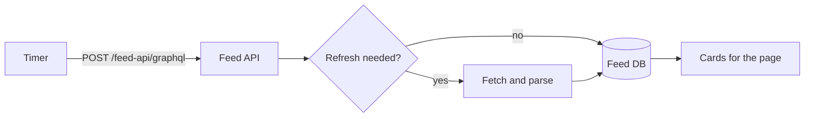

# Markdown preview sample

This file exercises everything the preview template renders. Open it in
nvim, press `<leader>mp`, then edit and `:w` to watch the browser reload.
The toolbar at the top right toggles light and dark; `n` and `p` jump
between review notes, `e` expands or collapses every thread, and `h` hides
the notes so the page reads as a reader would see it.

<!-- PV: a block note renders as a callout under the paragraph it follows. The body is markdown, so `code` and *emphasis* work inside a note. -->

## Review notes

A note is an HTML comment that starts with an uppercase tag and a colon.
It is invisible in any other markdown renderer and trivial to grep, which
is the whole point of writing review feedback this way.

<!-- PV: two notes on the same paragraph stack under it. -->
<!-- SK: the tag becomes the label, and each participant gets its own accent color, so a second reviewer is distinguishable at a glance. -->

Comments without a tag, or with a code marker such as `TODO:`, stay hidden.
There is one right after this paragraph and you should not see it.

<!-- TODO: this comment does not render -->

### Threads

A reply goes inside the note it answers, on its own lines before the
closing `-->`. Every line of a reply starts with one `>` per level of
depth, then the replier's tag on its first line. Depth is unlimited. A
thread with replies starts collapsed, showing the root and a reply count;
click the count, or press `n` onto a reply, to open it. The page remembers
which threads are open across reloads.

<!-- PV: the root note is one long line, the way nvim soft-wraps it while typing.
> FABLE: a reply, wrapped at seventy-two columns so the plain text stays
> readable. Markdown works here as well: `code`, *emphasis*, and a
> [link to this config](https://github.com/vpetro/vim-config).
>> PV: a reply to the reply has two markers.
>> SK: a second reply at the same depth is a sibling, not a child.
> FABLE: back at depth one, answering the root a second time.
>
> A blank quoted line inside a reply starts a new paragraph.
-->

### Notes on other block types

<!-- PV: headings can take a note as well. -->

- A note can hang off a list item and renders inside the item, under its
  text. Indent it to the item's content so the list stays intact.
  <!-- PV: nested notes work the same way as top-level ones.
  > FABLE: and a thread inside a list item works too.
  -->
- A note can also sit mid-sentence <!-- PV: an inline note is a highlight, not a callout --> and the
  sentence continues after it.
- A note placed in the middle of a paragraph splits the paragraph in two,
  so put notes after the paragraph or list item they refer to.

## Prose

On screen, body text uses the available window width with adaptive side
gutters, up to a 1152px maximum. The type scales with the viewport, from
16px in a small window to 22px on a large display. Paragraphs use
`text-wrap: pretty`, which avoids a lone word on the last line, and
headings use `text-wrap: balance`.

Inline formatting: **strong**, *emphasis*, ~~struck~~, `inline code`, and a
[link to this config](https://github.com/vpetro/vim-config). A long
bare URL wraps rather than overflowing:
https://github.com/vpetro/vim-config/pull/1234/files#diff-a-very-long-anchor-fragment-that-would-otherwise-push-the-column-wide

### Links show where they go

A link gets the icon of the service it points to, so the destination is
clear before the click: [EX-166](https://linear.app/example/issue/EX-166),
[this config](https://github.com/vpetro/vim-config),
[the daily notes](https://docs.google.com/document/d/abc/edit),
[the QA tracker](https://docs.google.com/spreadsheets/d/abc/edit),
[a deck](https://docs.google.com/presentation/d/abc/edit),
[a shared folder](https://drive.google.com/drive/folders/abc),
[the standup](https://meet.google.com/abc-defg-hij),
[a Slack thread](https://example.slack.com/archives/C123/p456),
[a Jira ticket](https://example.atlassian.net/browse/EX-1),
[a Confluence page](https://example.atlassian.net/wiki/spaces/EX/pages/1),
[a Datadog monitor](https://app.datadoghq.com/monitors/1),
[the Figma file](https://www.figma.com/design/abc/example),
[a Yahoo page](https://www.yahoo.com/),
[a talk](https://www.youtube.com/watch?v=abc),
[a paper](https://arxiv.org/abs/2401.00001),
[Wikipedia](https://en.wikipedia.org/wiki/Markdown), and
[a plain link with no icon](https://example.com/).

> A blockquote long enough to wrap onto a second line, so the left rule
> and the muted italic treatment are both visible.

> [!NOTE]
> GitHub-style alerts render as callouts. `TIP`, `IMPORTANT`, `WARNING`,
> and `CAUTION` each get their own accent color.

Footnotes work too.[^1]

[^1]: Rendered at the end of the document with a back link.

## Wide content

Code blocks and tables stay in the text column and scroll sideways when
they are wider than it. Diagrams may bleed past the column on both sides.
A note on any of them renders underneath, in the text column.

```ts
export async function refreshSource(sourceId: string, requestedBy: ConsumerId, options: RefreshOptions = {}): Promise<RefreshAcknowledgement> {
  const scheduled = await scheduler.enqueue({ sourceId, requestedBy, priority: options.priority ?? "normal" });
  return { sourceId, scheduledFor: scheduled.at, acknowledgedAt: new Date() };
}
```

<!-- PV: a note on a code block sits under it, in the text column. -->

```sh
npm run check
```

| Surface   | Cadence   | Owner      | Notes                                                                 |
|-----------|-----------|------------|-----------------------------------------------------------------------|
| Home page | 15 min    | feed-api   | Refreshed on a timer; the renderer never fetches sources on its own    |
| Archive   | hourly    | index-api  | The classifier runs only during a request-triggered refresh           |
| Search    | on demand | index-api  | Cache hit ratio drives the schedule                                    |



<!-- PV: a note on a diagram: the diagram keeps its bleed, the note stays in the column. -->

## Tasks

- [x] Replace the node-based preview plugin with pandoc
- [x] Render review notes under their block, as threads
- [ ] Delete this file once the template settles, or keep it as a fixture
